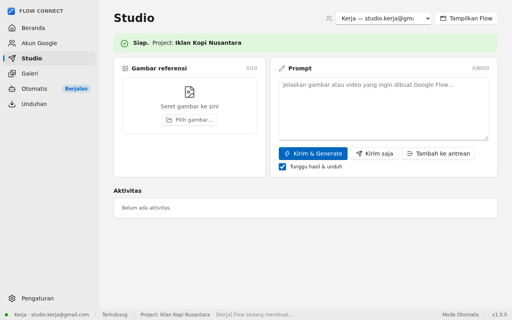
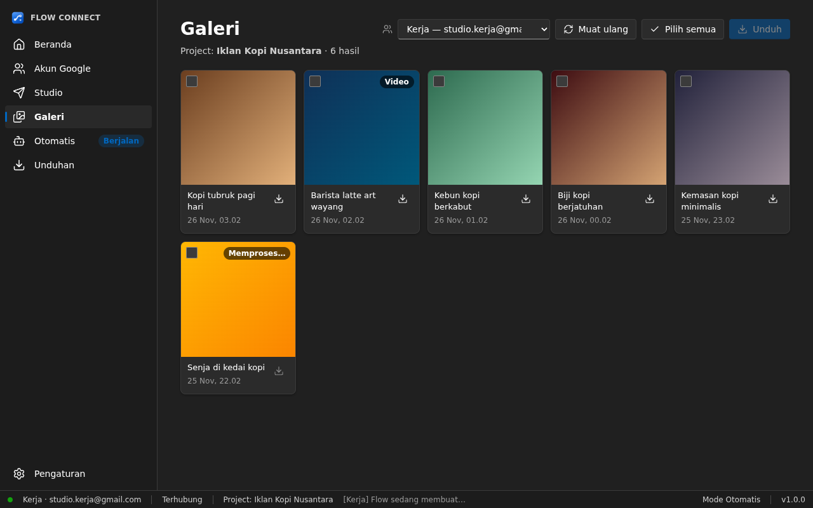

# FLOW CONNECT

**Live:** https://flow-connect-2qu.pages.dev

Clone tampilan [Google Flow](https://flow.google.com/) dengan desain baru **Aurora Neon**, berfungsi sebagai **hub akun Google**: login di FLOW CONNECT, tautkan beberapa akun Google, lalu buka Google Flow dengan akun mana pun. **Proses generate berjalan di Google Flow** memakai akun Google masing-masing pengguna.

> Tidak berafiliasi dengan Google. Google Flow tidak punya API publik dan tidak bisa di-embed (iframe), jadi Flow selalu dibuka di tab baru.

## Stack
- **Frontend:** Vite + React 19 + TypeScript + Tailwind CSS v4 + React Router
- **Backend:** Supabase (Auth, Postgres + RLS, Edge Function `link-google-account`)
- **Login Google:** Google Identity Services (opsional, aktif jika `VITE_GOOGLE_CLIENT_ID` di-set) — project `FLOW-CONNECT` (`zpuubgziohvqavmihgls`, ap-northeast-1)

## Menjalankan
```bash
npm install
cp .env.example .env   # sudah berisi URL & publishable key Supabase
npm run dev            # http://localhost:5173
```

## Deploy ke Cloudflare (Workers, static assets)
Konfigurasi: `wrangler.jsonc` (SPA fallback), header keamanan + cache di `public/_headers`.

**Opsi A — dari dashboard Cloudflare (tanpa token):**
1. Cloudflare Dashboard → *Workers & Pages* → *Create* → *Import a repository* → pilih `sugionoofficial/FLOW-CONNECT`
2. Build command: `npm run build` · Deploy command: `npx wrangler deploy` · branch: `main`
3. Setiap push ke `main` otomatis di-deploy ke `https://flow-connect.<subdomain>.workers.dev`

**Opsi A2 — Cloudflare Pages:** Framework preset `None` · Build command `npm run build` · Build output directory `dist`.
SPA routing otomatis (Pages menyajikan `index.html` untuk rute yang tidak ada filenya), `_headers` tetap berlaku. Versi Node diambil dari `.node-version`.

**Opsi B — GitHub Actions** (`.github/workflows/deploy-cloudflare.yml`):
1. Buat API token di Cloudflare (*My Profile → API Tokens → template "Edit Cloudflare Workers"*)
2. GitHub repo → *Settings → Secrets and variables → Actions* → tambahkan `CLOUDFLARE_API_TOKEN` dan `CLOUDFLARE_ACCOUNT_ID`
3. Push ke `main` (atau *Run workflow*) → build + deploy otomatis. PR hanya build & validasi.

**Manual dari komputer sendiri:** `npx wrangler login` lalu `npm run deploy`.
Uji lokal di runtime Cloudflare: `npm run cf:preview` (port 8787).

> Setelah domain produksi diketahui, set **Site URL** & **Redirect URLs** di Supabase → Authentication → URL Configuration.

## Alur aplikasi
| Halaman | Rute | Isi |
|---|---|---|
| Landing | `/` | Hero + prompt, model, Plan/Create/Refine, tools, films, FAQ |
| Masuk / Daftar | `/masuk` | Email + password (Supabase Auth) |
| **Hub akun Google** | `/app` | Daftar akun, tambah / default / label / hapus, tombol **Buka Google Flow** |
| **Studio** | `/app/studio` | Mode **Komputer**: kirim gambar/prompt, galeri + unduh lewat **Bookmarklet** atau **ekstensi Bridge**. Mode **HP**: kirim ke aplikasi Google Flow |
| Tools | `/app/tools` | 12 tools Google Flow, dibuka dengan akun pilihan |

Prompt yang diketik di hero landing dibawa ke hub dan otomatis disalin ke clipboard saat membuka Google Flow.

### Membuka Google Flow dengan akun tertentu
`https://accounts.google.com/AccountChooser?Email=<email>&continue=https://flow.google.com/?authuser=<email>`
Jika akun sudah login di browser → langsung masuk; jika belum → Google meminta login akun itu (di halaman resmi Google).

### Menambah akun Google
1. **Masuk dengan Google** (terverifikasi) — pop-up Google Identity Services → access token dikirim ke Edge Function `link-google-account` → diverifikasi ke Google (`tokeninfo`, `email_verified`, `aud`) → disimpan `verified = true`. Token langsung di-revoke; tidak ada token yang disimpan.
2. **Pakai email** (manual) — hanya pintasan, `verified = false`. Klien tidak bisa mengubah dirinya jadi terverifikasi (RLS + trigger).

Maksimal 10 akun per pengguna; akun pertama otomatis jadi default.

## Studio + Bookmarklet (tanpa instal)
Alternatif ekstensi: bookmark `javascript:` yang dijalankan pengguna di tab **flow.google.com** miliknya
(sumber: `src/bookmarklet/flow-connect-bookmarklet.js`, dibuat oleh `bookmarkletHref()` di `src/lib/flowLink.ts`).

- Komunikasi tab FLOW CONNECT ↔ tab Flow lewat `window.postMessage`, dua arah:
  1. Studio membuka tab Flow → pengguna klik bookmarklet → bookmarklet menyapa `window.opener`
  2. Pengguna klik bookmarklet → tombol “Buka FLOW CONNECT” di panel membuka Studio → bookmarklet menyapa jendela itu
- Origin dicek di kedua sisi: bookmarklet hanya menerima pesan dari origin FLOW CONNECT yang membuatnya; Studio hanya dari `https://flow.google.com`.
- Fitur sama dengan ekstensi: status akun/project, galeri (RPC baca-saja `Zzl0ze`/`as29s`), ambil file (Blob) untuk unduh,
  kirim gambar (File via postMessage) & prompt ke UI Flow. Tidak membuat token reCAPTCHA dan tidak menekan Generate.
- Tanpa `innerHTML`/`eval` (aman untuk Trusted Types). Kode di-inline penuh (~16 KB) karena CSP Flow memblokir script eksternal.
- Perlu diklik ulang setiap tab Flow dimuat ulang. React memblokir `href="javascript:"`, jadi tombol seret mengisi `href` lewat DOM.

> ⚠️ Belum diuji pada akun Google Flow sungguhan. Spesifikasi CSP menyatakan bookmarklet tidak boleh diblokir dan Firefox mematuhinya;
> jika Chrome/Google Flow memblokirnya, gunakan ekstensi. Jika Flow memutus hubungan jendela (COOP), sambungkan lewat tombol “Buka FLOW CONNECT” di panel bookmarklet.

## Studio + ekstensi FLOW CONNECT Bridge
Website lain tidak bisa mengakses Google Flow (cookie Google, CORS, iframe diblokir), jadi upload/download lewat FLOW CONNECT memakai
ekstensi browser kecil di `extension/` yang bekerja **di tab Google Flow milik pengguna sendiri** (akun & kuota Google mereka, tanpa API key).

| Aksi | Cara kerja |
|---|---|
| Status | membaca tab `flow.google.com` yang terbuka, akun yang login, dan project dari URL `/project/<id>` |
| Galeri | RPC baca-saja `Zzl0ze` (media project) & `as29s` (URL media) di konteks halaman Flow — tanpa reCAPTCHA |
| Unduh | `chrome.downloads` dari `flow-content.google` → folder `Downloads/FLOW CONNECT` |
| Kirim gambar | file dimasukkan ke UI Flow (input file / paste / drop) — **Flow sendiri** yang meng-upload |
| Tulis prompt | prompt diketik ke kotak prompt Flow; pengguna menekan **Generate** di Flow |

**Sengaja tidak dilakukan:** memanggil endpoint generate/upload Flow secara langsung atau membuat token reCAPTCHA dari ekstensi.
Google Flow mendeteksi hal itu (`extension_hijack_detected`) dan melewatinya berarti membobol proteksi Google → risiko akun diblokir.

- Paket: `npm run build:extension` → `public/downloads/flow-connect-bridge.zip` (otomatis saat `dev`/`build`, tidak di-commit).
- Pasang: ekstrak zip → `chrome://extensions` → *Developer mode* → *Load unpacked* → folder `flow-connect-bridge`.
- ID tetap `paedhhaejfnmdlgabmdjlncbjjpfdkfp` (dari `key` di manifest). Hanya menerima pesan dari `flow-connect-2qu.pages.dev` & `localhost:5173`.
- RPC id/format diambil dari riset open-source (crisng95/flowkit, ffroliva/gflow-cli, MIT) — API internal Google tidak resmi dan bisa berubah sewaktu-waktu.

## Studio mode HP → aplikasi Google Flow
HP tidak mendukung ekstensi, jadi di HP Studio otomatis memakai **aplikasi Google Flow resmi**
(Android `com.google.android.apps.labs.whisk`, iPhone App Store `id6751294549`). Bisa juga dipilih manual lewat tombol *Komputer / HP*.

1. Pilih gambar (galeri/kamera) & tulis prompt di FLOW CONNECT.
2. **Kirim ke aplikasi Flow** → prompt disalin ke clipboard, lalu menu *Bagikan* bawaan HP (Web Share API) terbuka berisi gambar → pilih Google Flow.
   - Jika browser tidak mendukung berbagi file: gambar disimpan ke HP, lalu aplikasi Flow dibuka (unggah dari galeri).
   - Tanpa gambar: aplikasi Flow langsung dibuka.
3. Di Flow: tempel prompt → Generate → Unduh hasil ke HP.

Membuka aplikasi: Android memakai intent URL (`intent://flow.google.com/#Intent;scheme=https;package=…;S.browser_fallback_url=<Play Store>;end`),
iPhone memakai link `https://flow.google.com/` (Universal Link). Hub di HP juga menampilkan tombol **Buka aplikasi Flow**.

> Catatan: apakah Google Flow muncul di menu *Bagikan* ditentukan oleh aplikasi Flow sendiri — jika tidak muncul, pakai jalur simpan ke galeri.

## FLOW CONNECT Desktop (aplikasi Windows) — `desktop/`
Aplikasi PC (Electron) dengan tampilan aplikasi sistem biasa (gaya Windows 11: font sistem, warna aksen Windows,
tema terang/gelap mengikuti sistem, menu bar & dialog bawaan). **Google Flow berjalan di Chrome/Edge asli** milik pengguna
di balik layar; aplikasi mengendalikannya lewat Chrome DevTools Protocol lokal (127.0.0.1).

- **Kenapa tidak webview?** Google memblokir login di browser tertanam. Jadi tiap akun = satu profil Chrome/Edge asli
  (`--user-data-dir`), login dilakukan di browser biasa **tanpa** kendali aplikasi ("Masuk ke Google"), lalu "Hubungkan"
  membuka browser yang sama dengan `--remote-debugging-port=0` (tanpa `--enable-automation`, tanpa `Runtime.enable`).
- **Fitur:** multi-akun, status akun/project, kirim gambar (`DOM.setFileInputFiles` ke input file Flow) & prompt
  (`Input.insertText`), galeri (RPC baca-saja `Zzl0ze`/`as29s`), unduh ke folder per akun, daftar unduhan.
- **Mode Aman (bawaan):** aplikasi mengisi gambar & prompt, lalu menampilkan jendela Flow — pengguna menekan Generate.
- **Mode Otomatis (opsional, wajib setuju peringatan risiko):** aplikasi mengklik tombol Generate Flow (klik mouse asli via CDP),
  menunggu hasil, mengunduh; **antrean** banyak prompt dengan jeda acak (min. 20 dtk), batas tugas per sesi, berhenti saat gagal.
  Tidak pernah membuat token reCAPTCHA atau memanggil RPC generate langsung. Risiko pembatasan akun Google tetap ada.
- Jendela browser: biasa / di belakang aplikasi / diperkecil (tidak bisa disembunyikan total).

| Studio (terang) | Galeri (gelap) |
|---|---|
|  |  |

```bash
cd desktop
npm ci              # ELECTRON_SKIP_BINARY_DOWNLOAD=1 bila hanya menjalankan uji
npm start           # jalankan aplikasi (butuh layar)
npm test            # uji integrasi dengan Chrome asli + server tiruan Google Flow (CHROME_PATH=…)
npm run dist:win    # installer NSIS + portable → desktop/dist
```

Rilis otomatis: workflow `.github/workflows/desktop.yml` menguji di Ubuntu & Windows (Chrome asli), membangun `.exe`,
menjalankan uji asap pada aplikasi hasil build, lalu menerbitkan GitHub Release `desktop-v<versi>` setiap push ke `main`.
Unduhan tetap: `releases/latest/download/FLOW-CONNECT-Desktop-Setup.exe` (dipakai tombol di Hub).
Aplikasi belum ditandatangani (code signing), jadi Windows SmartScreen akan memberi peringatan saat instal.

### Lisensi & pembaruan otomatis (v1.1.0+)

- **Lisensi** — pengguna membuat kunci `FC-XXXXX-…` di situs (`/app/lisensi`). Database hanya menyimpan hash SHA-256 kunci (`licenses`, `license_devices`, migrasi `20261127000001_desktop_licenses.sql`). Aplikasi memanggil RPC `activate_license` (anon) saat aktivasi, saat dibuka, dan tiap 6 jam; boleh offline hingga 7 hari. Kunci yang dicabut/kedaluwarsa langsung mengunci aplikasi. Default 3 PC per kunci, 5 kunci aktif per akun. Kunci disimpan terenkripsi (Windows DPAPI via `safeStorage`).
- **Pembaruan otomatis** — `electron-updater` + GitHub Releases. Workflow mengunggah `latest.yml` + `*.blockmap` bersama `.exe`. Versi installer menampilkan notifikasi “Update sekarang” → unduh di latar → “Mulai ulang & perbarui” (pasang senyap, tanpa instal ulang). Versi portable hanya diberi tahu & diarahkan ke unduhan. Rilis baru = naikkan `version` di `desktop/package.json` lalu merge ke `main`.
- Halaman situs: `/unduh` (unduhan + panduan), `/contoh` (galeri contoh video/foto/workflow/project beserta prompt & pengaturan).

## Setup Google OAuth (untuk tombol “Masuk dengan Google”)
1. [Google Cloud Console](https://console.cloud.google.com/) → buat/pilih project.
2. *APIs & Services → OAuth consent screen* → User type **External** → isi nama app `FLOW CONNECT`, email support, domain `flow-connect-2qu.pages.dev` → scopes: `openid`, `email`, `profile` → **Publish app** (agar semua akun Google bisa login, bukan hanya test users).
3. *APIs & Services → Credentials → Create credentials → OAuth client ID* → tipe **Web application**.
   - **Authorized JavaScript origins:** `https://flow-connect-2qu.pages.dev` dan `http://localhost:5173`
   - Redirect URI tidak diperlukan (pakai pop-up token).
4. Salin **Client ID** (`xxxx.apps.googleusercontent.com`):
   - Cloudflare Pages → project `flow-connect` → *Settings → Variables and Secrets* → tambah `VITE_GOOGLE_CLIENT_ID` (Production & Preview) → *Retry deployment*.
   - Lokal: isi `VITE_GOOGLE_CLIENT_ID` di `.env`.
   - (Disarankan) Supabase → *Edge Functions → Secrets* → `GOOGLE_CLIENT_ID` = Client ID yang sama, agar token dari aplikasi lain ditolak.

Tanpa Client ID, aplikasi tetap jalan dengan mode “Pakai email”.

## Database (`supabase/migrations`)
- `20261125000001_init_schema.sql` — skema awal (profiles, dsb.).
- `20261126000001_google_accounts_hub.sql` — menghapus sistem generate/kredit simulasi, menambah tabel `google_accounts` (RLS per user, unik `(user_id, email)`, satu default, batas 10) + RPC `set_default_google_account`.
- Edge Function: `supabase/functions/link-google-account`.

## Struktur
```
src/
  components/      UI umum, landing/, hub/ (akun Google), studio/ (mode HP)
  context/         Auth & Toast
  hooks/           useGoogleAccounts
  lib/             supabase client, api, google (Flow URL + GIS), bridge (ekstensi), flowLink (bookmarklet), connector, device (HP), catalog
  pages/           Landing, Login, Hub, Studio, Tools
design/            Pilihan template dark (referensi)
supabase/migrations, supabase/functions
desktop/            FLOW CONNECT Desktop (Electron, Windows) — main/ (browser, cdp, agent, flow, automation), renderer/ (UI)
extension/          FLOW CONNECT Bridge (Chrome MV3)
src/bookmarklet/    sumber bookmarklet Flow
scripts/            build-extension.mjs (zip ekstensi)
```
